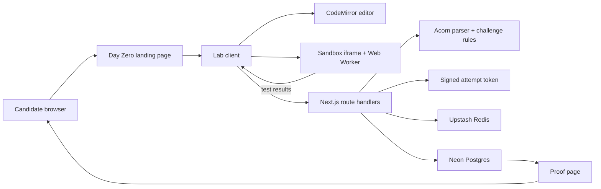

# Cynbit Intern / Day Zero

> **A better signal than a CV.**
>
> Day Zero is BitElevate's try-before-you-enroll engineering experience. A candidate picks a realistic bug, fixes it in a browser editor, runs the test suite, receives line-level review feedback, and earns a shareable proof when the patch is approved.

**Live product:** [cynbit-day-zero.vercel.app/day-zero](https://cynbit-day-zero.vercel.app/day-zero)  
**Repository:** [github.com/AnirudhPratapSinghYadav/cynbit-intern](https://github.com/AnirudhPratapSinghYadav/cynbit-intern)

---

## Contents

- [What this product does](#what-this-product-does)
- [Why it exists](#why-it-exists)
- [Product journey](#product-journey)
- [Architecture](#architecture)
- [Repository structure](#repository-structure)
- [Challenge model](#challenge-model)
- [How code execution works](#how-code-execution-works)
- [How review and approval work](#how-review-and-approval-work)
- [Demo mode vs production mode](#demo-mode-vs-production-mode)
- [Local development](#local-development)
- [Environment variables](#environment-variables)
- [Database setup](#database-setup)
- [Commands](#commands)
- [Deployment on Vercel](#deployment-on-vercel)
- [Security model](#security-model)
- [Testing and quality gates](#testing-and-quality-gates)
- [Adding a challenge](#adding-a-challenge)
- [Troubleshooting](#troubleshooting)
- [Known limitations](#known-limitations)

---

## What this product does

Day Zero is a small, measurable engineering assessment rather than a form or a generic coding quiz.

Each challenge gives the candidate:

1. A production-shaped bug.
2. Starter code in a browser editor.
3. Executable tests.
4. Hints that can be revealed when needed.
5. Automated review comments tied to source lines.
6. Up to three review rounds.
7. A shareable proof page after approval.

The current labs are:

| Lab | Engineering signal |
| --- | --- |
| JWT Expiry & Algorithm Check | Security reasoning and defensive validation |
| Event Listener Leak | Frontend lifecycle and cleanup discipline |
| Cache Key Collision & Invalidation | Data correctness and cache invalidation |

---

## Why it exists

Traditional applications over-index on claims:

- “I know JavaScript.”
- “I have completed a course.”
- “I can work on production systems.”

Day Zero asks for evidence instead:

- Can the candidate read unfamiliar code?
- Can they identify the actual failure mode?
- Can they use tests rather than guess?
- Can they respond to review feedback?
- Can they ship a smaller, safer fix?

The experience is intentionally short. The candidate should understand the brief quickly, make a meaningful change, and leave with a concrete artifact.

---

## Product journey

```text
Landing page
    |
    v
Choose a lab
    |
    v
Read ticket + starter code
    |
    v
Run tests in an isolated browser worker
    |
    v
Start attempt
    |
    v
Submit code + test results
    |
    +--> review comments / changes requested (maximum 3 rounds)
    |
    v
Approved proof
    |
    +--> copy link / QR code / enroll at BitElevate
```

The landing page is deliberately editorial and architectural. The editor experience becomes denser and more operational because the candidate needs focus while working.

---

## Architecture



### Runtime responsibilities

| Area | Responsibility |
| --- | --- |
| Next.js App Router | Pages, metadata, route handlers, deployment |
| React client components | Editor, attempt state, test output, review thread |
| CodeMirror 6 | JavaScript editing experience |
| Sandbox iframe | Browser boundary for code execution |
| Web Worker | Time-limited execution of candidate code and tests |
| Acorn | Parses submitted code without executing it on the server |
| Challenge rules | Static AST checks for review feedback |
| Upstash Redis | Rate limits and one-time nonce consumption in production |
| Neon Postgres | Approved proof records in production |
| Drizzle ORM | Typed database access and schema definition |

---

## Repository structure

```text
cynbit-day-zero/
├── public/                         Static assets
├── scripts/
│   ├── file-size.mjs               Enforces the 60-line source-file limit
│   └── no-comments.mjs             Enforces the no-comments source rule
├── src/
│   ├── app/
│   │   ├── page.tsx                Redirects `/` to `/day-zero`
│   │   ├── layout.tsx              Global metadata, header, footer
│   │   ├── day-zero/
│   │   │   ├── page.tsx            Landing page and lab selection
│   │   │   └── [lab]/
│   │   │       ├── page.tsx        Challenge lookup and metadata
│   │   │       └── LabClient.tsx   Client-side lab orchestration
│   │   ├── api/attempt/
│   │   │   ├── start/route.ts      Issues a signed attempt token
│   │   │   └── submit/route.ts     Reviews and approves submissions
│   │   ├── proof/[id]/
│   │   │   ├── page.tsx            Proof page
│   │   │   └── opengraph-image.tsx Social preview image
│   │   ├── go/enroll/route.ts      Tracks enrollment intent and redirects
│   │   └── sandbox/frame/page.tsx  Worker execution boundary
│   ├── components/                 Small reusable UI pieces
│   ├── features/
│   │   ├── attempt/                Client API calls and attempt state
│   │   ├── challenges/             Challenge definitions, tests, and rules
│   │   ├── editor/                 CodeMirror setup and theme
│   │   ├── proof/                  QR generation and proof actions
│   │   ├── reviewer/               Server-side AST review entry point
│   │   └── runner/                 Sandbox messages and iframe client
│   ├── lib/                        Small shared primitives
│   ├── server/
│   │   ├── attempt/                Token lifecycle and proof completion
│   │   ├── db/                     Neon client, schema, proof queries
│   │   ├── security/               Validation, signing, IP, rate limits
│   │   └── env.ts                  Environment parsing and demo detection
│   ├── styles/
│   │   ├── globals.css             Product layout and visual system
│   │   └── tokens.css              Color, typography, and spacing tokens
│   └── middleware.ts               CSP and security response headers
├── .env.example                    Environment variable template
├── next.config.ts                  Next.js and Turbopack configuration
├── package.json                    Scripts and dependencies
└── README.md                       This document
```

### Why the files are split this way

The project groups code by product feature instead of creating large generic folders:

- A challenge's definition, tests, and review rules live together.
- The lab page handles orchestration, not every visual detail.
- Editor, ticket, proof, and review UI each have one clear responsibility.
- Server concerns are separated from browser concerns.

The repository also enforces a 60-line source-file limit. This is intentionally strict: the codebase should remain readable by a human reviewing a candidate assessment product.

---

## Challenge model

Every challenge implements the `Challenge` shape in `src/features/challenges/types.ts`:

```ts
type Challenge = {
  id: string
  lab: string
  branch: string
  fileTarget: string
  title: string
  description: string
  starter: string
  hints: [string, string]
}
```

Each challenge folder contains:

```text
challenge-name/
├── index.ts     Candidate-facing metadata and starter code
├── tests.ts     Test program executed in the browser worker
└── rules.ts     AST-based review rules executed on the server
```

The challenge is registered in `src/features/challenges/index.ts`, which connects:

- the challenge definition;
- its test suite;
- its review rule function.

---

## How code execution works

Candidate code is **not executed on the server**.

1. The lab posts `{ code, tests }` to the hidden sandbox iframe.
2. The iframe creates a Web Worker from a `data:` URL.
3. The worker evaluates the code and tests inside the browser.
4. Results are capped and posted back to the lab.
5. A two-second timer terminates the worker if it hangs.
6. The iframe uses a restrictive sandbox attribute and CSP.

This is suitable for the public assessment demo because execution stays in the candidate's browser. It is not a general-purpose untrusted-code hosting platform.

The server receives the submitted source only for static review:

1. Input is validated with Zod.
2. Source size is capped at 8,000 characters.
3. Acorn parses the source.
4. Challenge rules inspect the AST.
5. The server never evaluates the submitted source.

---

## How review and approval work

### Starting an attempt

`POST /api/attempt/start`

```json
{ "challengeId": "jwt-expiry" }
```

The server issues a signed token containing:

- challenge ID;
- nonce;
- start timestamp;
- current round;
- expiry timestamp.

### Submitting an attempt

`POST /api/attempt/submit`

```json
{
  "token": "signed-attempt-token",
  "code": "candidate source",
  "results": [
    { "name": "valid token not expired", "passed": true }
  ]
}
```

The server then:

1. Verifies the token signature and expiry.
2. Rejects submissions that arrive too quickly.
3. Runs the challenge's Acorn-based review rules.
4. Requires every submitted test result to pass.
5. Requests changes when review comments or failed tests remain.
6. Closes the attempt after three rounds.
7. Creates a proof after approval.

The client never decides approval by itself. Browser test output is evidence submitted to the server; server-side review rules still determine whether the attempt is approved.

---

## Demo mode vs production mode

The deployed public product currently runs in **demo mode** so it can work without requiring you to create Neon and Upstash accounts first.

Demo mode provides:

- public landing page;
- browser code editor;
- browser test execution;
- static review feedback;
- attempt flow;
- demo proof page;
- BitElevate enrollment redirect.

Demo mode does **not** provide durable proof storage or distributed rate limiting. Demo proof data is intentionally not presented as a production certificate.

Production mode activates automatically when all three service groups are configured:

- `DATABASE_URL`;
- `UPSTASH_REDIS_REST_URL`;
- `UPSTASH_REDIS_REST_TOKEN`.

When production infrastructure is configured:

- proofs are stored in Neon Postgres;
- nonces are consumed once through Redis;
- rate limits use Upstash;
- proof pages read real records.

This lets the product ship publicly first without silently pretending that demo storage is production infrastructure.

---

## Local development

### Requirements

- Node.js 20 or newer
- npm
- A modern browser

### Install

```bash
git clone https://github.com/AnirudhPratapSinghYadav/cynbit-intern.git
cd cynbit-intern
npm install
```

### Start the app

```bash
npm run dev
```

Open [http://localhost:3000/day-zero](http://localhost:3000/day-zero).

The app starts in demo mode with no external services required:

```text
DATABASE_URL              optional in demo mode
UPSTASH_REDIS_REST_URL    optional in demo mode
UPSTASH_REDIS_REST_TOKEN  optional in demo mode
```

Copy `.env.example` to `.env.local` only when you need to override URLs or enable production services:

```powershell
Copy-Item .env.example .env.local
```

Never commit `.env.local` or any real credentials.

---

## Environment variables

| Variable | Required for demo | Required for production | Purpose |
| --- | ---: | ---: | --- |
| `DATABASE_URL` | No | Yes | Neon/Postgres connection URL |
| `UPSTASH_REDIS_REST_URL` | No | Yes | Upstash Redis REST endpoint |
| `UPSTASH_REDIS_REST_TOKEN` | No | Yes | Upstash Redis REST token |
| `SIGNING_SECRET` | No | Recommended | HMAC secret; use at least 32 characters |
| `SITE_URL` | No | Yes | Canonical public site URL |
| `ENROLL_URL` | No | No | BitElevate enrollment destination |
| `NEXT_PUBLIC_SITE_URL` | No | No | Optional client-visible site URL |

A safe local demo configuration is:

```env
SITE_URL=http://localhost:3000
ENROLL_URL=https://www.cynbit.in/bitelevate
```

The application supplies a development-only signing secret when `SIGNING_SECRET` is absent. Use a real secret in any serious deployment.

---

## Database setup

The database schema is defined in:

```text
src/server/db/schema.ts
```

The `proofs` table stores:

| Column | Meaning |
| --- | --- |
| `id` | Public proof UUID |
| `challenge_id` | Challenge identifier |
| `lab` | Lab label shown on the proof |
| `rounds` | Number of review rounds |
| `duration_ms` | Time from attempt start to approval |
| `nonce` | One-time completion value |
| `enroll_clicked_at` | Enrollment click timestamp |
| `created_at` | Proof creation time |

For production, provision a Neon Postgres database, set `DATABASE_URL`, and apply the schema through your chosen Drizzle migration workflow before enabling real proof persistence.

---

## Commands

| Command | Use |
| --- | --- |
| `npm run dev` | Start Next.js with Turbopack |
| `npm run build` | Create the production build |
| `npm run start` | Serve the production build |
| `npm run lint` | Run ESLint with zero warnings allowed |
| `npm run typecheck` | Run TypeScript without emitting files |
| `npm run test` | Run Vitest once |
| `npm run test:watch` | Run Vitest in watch mode |
| `npm run check:comments` | Reject comments in source files |
| `npm run check:size` | Enforce the 60-line source-file limit |
| `npm run check` | Run all quality gates |

Before opening a pull request, run:

```bash
npm run check
npm run build
```

---

## Deployment on Vercel

The GitHub repository is connected to the Vercel project `cynbit-day-zero`.

### Demo deployment

No external service credentials are needed:

1. Push to the `master` branch.
2. Vercel installs dependencies.
3. Vercel runs `npm run build`.
4. Demo mode is selected automatically.
5. The deployment becomes public at the Vercel project domain.

### Production deployment

In Vercel Project Settings → Environment Variables, add:

```text
DATABASE_URL
UPSTASH_REDIS_REST_URL
UPSTASH_REDIS_REST_TOKEN
SIGNING_SECRET
SITE_URL
ENROLL_URL
```

Redeploy after adding or changing variables. Do not paste credentials into GitHub, source files, screenshots, or issue comments.

### Public deployment

Deployment protection must be disabled if the assessment is intended for anonymous candidates. If protection is enabled, visitors will be redirected to a Vercel login page before seeing the app.

---

## Security model

The project has several intentional boundaries:

- Zod validates API payloads.
- Challenge IDs are an allowlisted enum.
- Code and token payloads have explicit size caps.
- Candidate code is parsed, not executed, on the server.
- Browser execution is isolated in a sandboxed iframe and worker.
- Worker execution has a two-second timeout.
- Attempt tokens are signed with HMAC.
- Production nonces are one-time values in Redis.
- Production routes are rate-limited by client IP.
- Security response headers are applied in middleware.
- Enrollment redirects use the configured `ENROLL_URL`, never a request-supplied destination.

The sandbox contains `new Function` intentionally. It exists only inside the browser sandbox route and is not used by server-side review.

---

## Testing and quality gates

The current automated test covers the reviewer path:

- missing JWT safeguards produce the expected review comments;
- guarded JWT code produces no comments.

The browser journey has also been manually verified against the deployed URL:

- landing page renders;
- challenge page renders;
- worker executes tests;
- test results appear in the UI;
- no external database or Redis service is required in demo mode.

The repository's `npm run check` command is intentionally strict. A pull request is not ready when it only “looks right”; it must pass lint, types, tests, source rules, and file-size rules.

---

## Adding a challenge

1. Create a folder under `src/features/challenges/`.
2. Add `index.ts` with the challenge metadata and starter code.
3. Add `tests.ts` with a test program that returns `{ name, passed }[]`.
4. Add `rules.ts` with AST-based review rules.
5. Register the challenge in `src/features/challenges/index.ts`.
6. Add the challenge ID to `CHALLENGE_IDS` in `src/server/security/schemas.ts`.
7. Run:

```bash
npm run check
npm run build
```

A good challenge should:

- have one clear failure mode;
- be solvable within roughly twelve minutes;
- test reasoning rather than trivia;
- have tests for the happy path and important edge cases;
- produce useful review comments when the candidate makes a partial fix;
- avoid requiring external network access.

---

## Troubleshooting

### Vercel build says environment variables are missing

The current app supports demo mode. Confirm that the deployment uses the latest `master` commit. If you want production persistence, add the six variables in the Vercel project settings and redeploy.

### Vercel shows a login page

Deployment protection is enabled. Disable SSO/deployment protection for a public candidate assessment, or share the deployment only with authenticated reviewers.

### The editor loads but tests do not return

Check:

1. The sandbox iframe is present in the browser.
2. The browser console has no CSP error.
3. The response is not a timeout.
4. The deployment includes the latest sandbox worker fix.

### Proof pages do not load in production mode

Confirm that:

1. `DATABASE_URL` points to a reachable Neon database.
2. The `proofs` table exists.
3. `SITE_URL` is a valid absolute URL.
4. The proof UUID is valid.

### Enrollment redirects to the wrong place

Set `ENROLL_URL` to the canonical BitElevate enrollment URL. The route deliberately ignores arbitrary redirect query parameters.

---

## Known limitations

- Demo mode does not persist proof records between deployments.
- Production database migrations are not generated automatically by `npm run build`.
- The current reviewer is deterministic AST rule logic, not a human mentor system.
- The sandbox is designed for this assessment flow, not arbitrary code execution as a service.
- The current browser test coverage is focused and should grow with new challenge types.
- The project uses Next.js middleware; newer Next.js versions may recommend migrating that convention to `proxy`.

---

## Product principles

1. **Evidence over claims.** The candidate should leave an artifact.
2. **Small surfaces, clear ownership.** Files and features should stay easy to review.
3. **Browser execution, server review.** Never execute candidate code on the server.
4. **Demo honestly.** A demo should be useful without pretending to be production infrastructure.
5. **Every interaction earns its place.** The experience should feel like a real engineering brief, not an admin dashboard.

---

## License and ownership

This repository is a Cynbit/BitElevate product project. Add an explicit license before distributing the code outside the intended organization.
